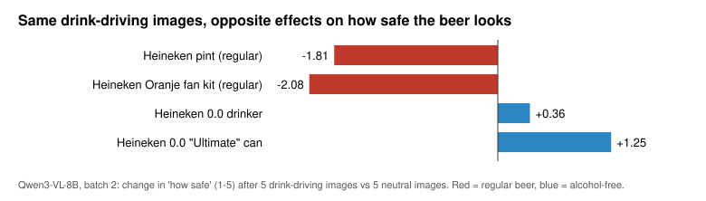

# Agents reading ads

**What do firms put in their ads, and how does an AI agent read those ads in context?**

Advertising works by attaching a brand to cues people will meet again: a match day, a celebrity,
a feeling. We scraped every ad five French betting firms ran on Snapchat, had a model code what
each one is made of, and compared the firms' strategies. Then we showed real ads to a
vision-language model inside social-media feeds and changed only the surrounding images, to see
how context changes what the agent reads into the same ad.

This repository contains everything from that work, October-November 2026:

- **all of the data we are allowed to share**: the ad-library captures (3,241 Snapchat ads from
  five betting firms, a 1,000-ad corpus of betting, alcohol and control ads, Bing and TikTok
  pilots), every model label and derived table, every agent run including the first pilots, and
  the celebrity-brand association data;
- **our results**, regenerated from that data by one script that needs no API key and no network;
- **our interpretation**, in [`my-takeaways.md`](my-takeaways.md);
- **the exact code** that collected and analysed it, so you can rerun any part with your own key
  or hardware. The ad creatives themselves are not redistributed; a manifest of public URLs and
  checksums and a fetch script get them back.

## The headline results

**Firms' ads, represented by what they are made of.** Every unique creative (951 of them) was coded
against a frozen codebook; each firm is the impression-weighted mix of its creatives.

| | Winamax | PMU | Unibet | Betsson | bet365 |
|---|---:|---:|---:|---:|---:|
| share of the panel's impressions | 57% | 13% | 25% | 1% | 4% |
| impressions where the **offer amount** dominates the ad | 23% | 57% | 61% | 56% | 60% |
| impressions where the **headline** dominates the ad | 62% | 11% | 7% | 35% | 31% |
| most distinctive cue vs rivals | poker tournaments 5.6× | racing events 18.7× | no-deposit bonus 46× | single fixtures 3.6× | national-team football 5.1× |

The incumbent sells a message; the challengers sell the deal. Firms differentiate through
verticals (racing, poker, MMA), not tone; 71% of all creatives tie the brand to a specific event
and 52% to a sport. When a shared event dominates, the firms' cues converge: ads launched in June 2026,
during the World Cup, were the most alike of any month.

**An agent reading those ads in a feed.**



Five drink-driving images before a Heineken ad make the regular beer look less safe (−1.81 and
−2.08 on a 1-5 scale) and the alcohol-free beer look *safer* (+0.36 and +1.25). The same context
pushes in opposite directions depending on where the product sits relative to it. Beer effects are
graded with the number of images and replicate on fresh draws; betting ads barely move because the
model already rates them near maximally risky; and images placed *after* the ad move the ratings as
much as images before it, which no human scrolling a feed could show.

Why we read these results the way we do, what went wrong along the way, and what the data cannot
say: **[my-takeaways.md](my-takeaways.md)**.

## Where to look

| if you want… | go to |
|---|---|
| our interpretation | [`my-takeaways.md`](my-takeaways.md) |
| every results table | [`results/RESULTS.md`](results/RESULTS.md) (CSV versions alongside) |
| what every data file and field means | [`DATA.md`](DATA.md) |
| the ad-library captures and firm labels | [`ad-library/`](ad-library) ([README](ad-library/README.md)) |
| the agent runs, question by question | `agent-feeds/runs/*/responses.jsonl` ([README](agent-feeds/README.md)) |
| our findings notes from the time | [`agent-feeds/docs/batch1-findings.md`](agent-feeds/docs/batch1-findings.md), [`batch2-findings.md`](agent-feeds/docs/batch2-findings.md), [`ad-library/docs/ads_as_cues_data_linkages.md`](ad-library/docs/ads_as_cues_data_linkages.md) |
| the celebrity-brand association work | [`brand-associations/`](brand-associations) ([README](brand-associations/README.md)) |

## The three parts

| part | what it does | original project |
|---|---|---|
| [`ad-library/`](ad-library) | **Scraping and firm representations.** Collectors for the Snap Ads Gallery (plus Bing and TikTok pilots); model coding of every unique creative; firm profiles, cue similarity, distinctive features | betting-ads-research |
| [`agent-feeds/`](agent-feeds) | **Agents reading ads.** Qwen3-VL-8B rates real ads inside feeds whose other images we randomize; two batches, 1,456 feeds | agentic-ad-simulations |
| [`brand-associations/`](brand-associations) | **Celebrity-brand representations.** Directed association from news, Wikipedia, search and a language model; event studies; outfit look-size studies | implicit-ads |

Each part keeps its original layout, code, `pyproject.toml` and `uv.lock`, so its commands run from
inside its folder. Each part's README lists every change we made for this release.

```
my-takeaways.md     our interpretation of the results
results/            tables and figures, generated by analysis/make_results.py
analysis/           the script that builds results/ from the saved data
DATA.md             codebook for every data and output file
ad-library/         collectors, labelling and analysis code + captures, labels, panels
agent-feeds/        design, runner and analysis code + every run
brand-associations/ association measures, demo pipeline, studies + derived data and briefs
tests/              checks that the data reproduces the reported results, and release hygiene
```

## Reproduce our results (no API key)

Needs only Python 3.11 or newer; no packages, no network.

```bash
python3 analysis/make_results.py     # rewrites results/ from the saved data
```

The output is deterministic. `make check` regenerates it and fails if anything differs from the
committed `results/`. `make test` (needs [uv](https://docs.astral.sh/uv/)) also checks the headline
numbers, that the original analysis scripts rebuild our committed firm panels byte for byte, that
the original design code regenerates exactly the feeds in our agent runs, and that no creative,
credential or machine path is tracked.

## Rerun the experiments (your own key or hardware)

Each part's README has the commands in the order we ran them. In short:

- **Collection** (`ad-library/`): the Snap Ads Gallery is public and needs no account. A new
  collection will not match ours (ads come and go, impressions keep growing); our captures are the
  record.
- **Getting the creatives**: `python ad-library/scripts/fetch_media.py` re-downloads all 1,480
  files (~0.7 GB) from the public URLs we recorded and verifies each SHA-256.
  `agent-feeds/scripts/fetch_stimuli.py` rebuilds the 80 stimulus images byte for byte.
- **Creative labelling** (`ad-library/`): Claude Sonnet through the Claude Code CLI, one call per
  creative. Our full run took 954 calls with a reported cost-equivalent of about $96.
  GABRIEL validation runs used an OpenAI model. Put keys in `.env` (see `.env.example`).
- **Agent experiments** (`agent-feeds/`): a local model on an Apple-silicon Mac via MLX; no key.
  Batch 1 took 166 minutes.
- **Associations** (`brand-associations/`): public sources and a local language model; no key.

## What is not included

- **Ad creatives** (images, videos, frames, contact sheets, and HTML reports or CSV columns that
  embedded them). They are third-party copyrighted works. `ad-library/data/media_manifest.csv`
  lists each one's ad ID, public library URL and SHA-256.
- **Third-party text**: cached news articles and web pages, Common Crawl News full texts, extracted
  article text. Headlines, URLs and short evidence spans are kept as metadata.
- **StockX-derived data** from one exploratory study, because our notes flagged that StockX's terms
  needed clearing first.
- Our private working notes, planning documents and presentation decks, an unrelated data
  workstream, run logs with machine paths, caches and environments.

**Compliance.** The ad metadata here was captured from public ad libraries (Snap Ads Gallery,
Microsoft Advertising Ad Library, TikTok Commercial Content Library) that publish it for
transparency and research. It remains subject to those libraries' terms; please respect their terms
and rate limits (and any robots rules) if you collect more, and do not redistribute creatives you
download. The fetch scripts identify themselves, pause between requests and keep only files whose
checksum matches ours.

## References

- Bordalo, P., Burro, G., Gennaioli, N., Nacamulli, G., & Shleifer, A. (2025). *Ads as Cues.* NBER
  Working Paper 34387. The framework behind all three parts; the 0.46 / 0.25 text-similarity
  benchmarks we compare with are theirs.
- Bordalo, P., Coffman, K., Gennaioli, N., & Shleifer, A. (2016). *Stereotypes.* Quarterly Journal
  of Economics. Representativeness as "firm share ÷ rival share".
- Bordalo, P., Gennaioli, N., & Shleifer, A. (2013). *Salience and Consumer Choice.* Journal of
  Political Economy. The salience reading of the alcohol-free result.
- Sarkar, S. (2026). *Economic Representations.* Firms as the average embedding of their coverage.
- Gentzkow, M., & Shapiro, J. M. *Code and Data for the Social Sciences: A Practitioner's Guide.*

## License and citation

Code: MIT. Our data and write-up: CC BY 4.0. Third-party ad metadata stays under the source
libraries' terms; see [`LICENSE`](LICENSE). If you use any of this, please cite the repository
(see [`CITATION.cff`](CITATION.cff)).
