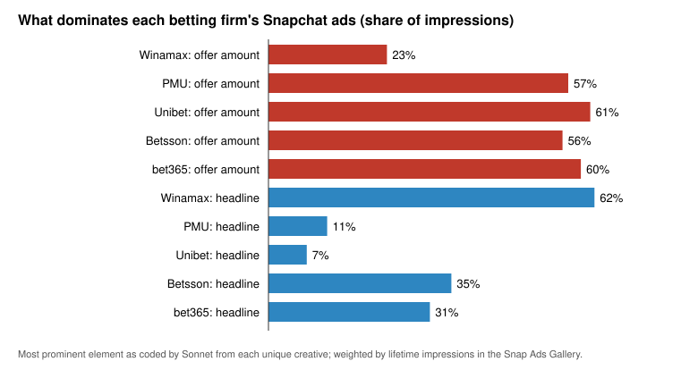
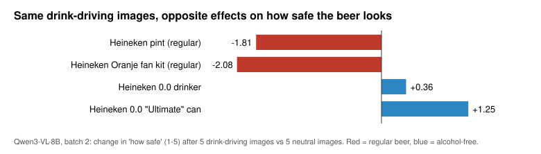

# My takeaways

This is our interpretation of the work in this repository. It is opinion backed by data, not a
paper. Numbers marked ✓ are regenerated by `python analysis/make_results.py` (see
[`results/RESULTS.md`](results/RESULTS.md)). Numbers marked ◇ come from our working notes at the
time and are not rebuilt by the script, although the data behind them are in this repository
unless we say otherwise. Where we add a reading that was not in our notes, or where re-running
the numbers corrected a note, it is marked **[new reading]**.

The work ran from 8 October to 10 November 2026 in three projects, which became the three parts
of this repository:

- [`ad-library/`](ad-library): scraping public ad libraries and representing firms by their ads;
- [`agent-feeds/`](agent-feeds): an AI agent reading those ads inside a feed;
- [`brand-associations/`](brand-associations): directed celebrity-brand associations.

The thread through all three is the *Ads as Cues* view (Bordalo, Burro, Gennaioli, Nacamulli &
Shleifer, 2025): an ad is a cue, a cue brings goods to mind in proportion to similarity and
experience, and whatever else the cue brings to mind interferes. We wanted to see that on the
supply side (which cues firms choose), in how an artificial reader interprets a cue in context,
and in which direction celebrity cues point.

---

## Part 1. What five betting firms' ads are made of

**How the data were made.** We pulled every ad the Snap Ads Gallery returned for five French
sports-betting firms: Winamax, PMU, Unibet, Betsson and bet365. That is 3,241 ads ✓, 676 unique
creatives in the base run ✓, plus the media of Story ads, which our collector initially missed.
Each of the 951 unique creatives ✓ was coded once by Claude Sonnet against a frozen codebook: 17
"borrowed meaning" categories (fandom, national pride, money, humour, ...) rated 0-3 for
prominence, how betting is framed, the offer, the template, what dominates the creative and how
prominent the brand is. The model saw only the image or video frames (and a transcript of the
audio), never the firm's name or the metadata. A firm's representation is the
impression-weighted mix of its creatives' codes. Coding cost about $96 in cost-equivalent terms
over 954 calls ✓.

This is the supply of cues, not their effect. We see what firms put in front of people and how
widely, not who saw it or what they did next.

### Takeaway 1: Betting ads attach the brand to watching football

| | |
|---|---:|
| creatives tied to a specific event cue | 676 of 951 (71%) ✓ |
| creatives tied to a sport cue | 492 of 951 (52%) ✓ |
| share of each firm's ads featuring football | 51% (Winamax) to 95% (bet365) ✓ |
| Betsson ads using a match-card template | 53% ✓ |

Our reading: in the model, frequent "neutral" experiences mostly interfere with recall of a brand.
Betting ads try to turn one of them, watching a match, into a cue for the brand. If that works,
every future fixture brings the brand to mind with no ad at all, on a public schedule. It is the
Corona-and-the-beach mechanism in its strongest form.

### Takeaway 2: The incumbent makes its message salient; the challengers make the deal salient

| | Winamax | PMU | Unibet | Betsson | bet365 |
|---|---:|---:|---:|---:|---:|
| share of panel impressions | 57% ✓ | 13% ✓ | 25% ✓ | 1% ✓ | 4% ✓ |
| impressions where the **offer amount** dominates | 23% ✓ | 57% ✓ | 61% ✓ | 56% ✓ | 60% ✓ |
| impressions where the **headline** dominates | 62% ✓ | 11% ✓ | 7% ✓ | 35% ✓ | 31% ✓ |
| impressions with maximal brand prominence | 26% ✓ | 44% ✓ | 76% ✓ | 76% ✓ | 99.9% ✓ |
| impressions per creative (millions) | 8.6 ✓ | 5.0 ✓ | 9.3 ✓ | 0.3 ✓ | 2.4 ✓ |
| creatives first run before 2025 | 183 ✓ | 0 ✓ | 32 ✓ | 50 ✓ | 0 ✓ |

Winamax looks like an incumbent maintaining a habit: most of the panel's impressions, 183 evergreen
creatives and 8.6 million impressions per creative, ads led by a headline, and the brand often not
at maximal prominence because its assets (the red W, cash, poker) are already encoded. The
challengers lead with the offer and put the brand at full prominence. Betsson looks like
acquisition and testing: 0.3 million impressions per creative and 5 ads per creative ✓. Salience
decides what gets encoded; similarity decides what is retrieved later.

### Takeaway 3: Firms differentiate through verticals, not tone

The features most over-represented in each firm's ads relative to its rivals ✓:

| firm | most representative features (firm share ÷ rival share) |
|---|---|
| PMU | racing events 18.7×, horse racing 11.8×, cash bonus 7.0× |
| Unibet | no-deposit bonus 46.4×, combat sports (MMA) 10.1× |
| Winamax | poker tournaments 5.6×, jackpots 5.4×, humour 4.0× |
| bet365 | national-team football 5.1×, national pride 3.8×, boosted odds 3.0× |
| Betsson | single fixtures 3.6×, first-bet refund 2.6×, product utility 2.1× |

Firms that own a non-football vertical (racing, poker, MMA) occupy cues their rivals cannot
retrieve. Firms competing only on football rely on offers and brand prominence. In the
stereotype sense of Bordalo, Coffman, Gennaioli & Shleifer, a firm's image is its representative
features, not its most frequent ones, and this ratio measures exactly that.

### Takeaway 4: The firms' cues are similar, and converged at the World Cup

- Cosine similarity of ad-text word stems between firm pairs runs 0.365-0.704, mean 0.450 ✓. *Ads as
  Cues* reports 0.46 for same-category brand pairs and 0.25 across categories (cited, not
  computed; the corpora and method differ, so this is a rough comparison).
- Similarity of the coded cue mixes is higher, 0.545-0.926 by impressions ✓; bet365-Betsson is the closest pair ✓.
- Ads launched in the same month were most alike in **June 2026, 0.77** ✓ (Winamax-bet365 0.73 ✓).
  Our notes put the other 2026 months at 0.35-0.64; re-running shows **August at 0.25** ✓, when
  only Winamax and bet365 launched **[new reading]**.

By the model's logic, a challenger whose cues resemble the leader's helps the leader with the
leader's habitual users. Our hypothesis from this: bet365's World Cup push may have raised betting
on *Winamax* among Winamax users, the betting version of a Pepsi ad selling Coke. The data here
cannot test it.

### Takeaway 5: Targeting and timing look like habit management

- Winamax and Unibet target men only on almost every ad (99% and 100% ✓) and mostly cap the age
  (77% and 89% of their ads have an upper age limit ✓; mostly 18-45 in our notes ◇). PMU and bet365 target all
  genders from 18 (5% and 0% men-only ✓). Betsson is also men-only (95% ✓) but never sets an upper
  age (0% ✓); our notes grouped it with the 18-45 targeting **[new reading]**.
- **Unibet launched nothing after 19 March 2026** ✓, a possible "going dark" episode if the archive
  is complete. It is the natural test of the model's claim that brands which stop advertising lose
  demand slowly.

### What we can and cannot claim from the panel

We can describe the supply of cues: content, similarity, timing, repetition and targeting, and say
whether firm behaviour is consistent with the content implications in *Ads as Cues*. We cannot say
that any ad changed recall or demand, who is habitual, or that spillovers exist in betting. The
main threats:

- **The labels are not validated against people.** We built a blinded 60-creative validation
  packet and ran the model side on the 30 still images ◇; the human coding has not been done.
- Story ads with several snaps were coded from the first snap only.
- Winamax and Betsson hit the 1,000-ad quota ✓, so their archives are truncated.
- Impressions are lifetime totals with no end dates; archive presence is not exposure.
- The sports calendar moves every firm at once, which looks like strategic convergence.

### Things we got wrong in collection

- **Story ads keep their media somewhere else.** 1,155 of the panel's records ✓ were Story ads whose
  media links sit inside `composite_preview.ad_snaps`; the first collector did not look there and
  reported no error. A backfill recovered them, and on the 1,000-ad corpus it raised media coverage
  from 709 to 896 records ✓.
- **An API error looked like the end of the results.** Our first panel run treated some errors as
  exhausted pagination; we stopped it after 163 records ✓, marked it invalid, and made pagination
  fail closed.
- **The per-ad detail endpoint rate-limits.** A 100-ad calibration hit repeated HTTP 429s ◇, so the
  production runs used search results only.

---

## Part 2. How an AI agent reads an ad depends on the feed around it

**How the data were made.** Qwen3-VL-8B (4-bit, run locally, temperature 0) sees a social-media
feed: one real ad and up to five other images, in scrolling order. We change only the other
images: neutral posts, pubs and beer gardens, drink-driving and crashes, sports wins, losses and
distress, or colour-matched look-alikes with no meaning. We vary how many come right before the ad
(1, 3, 5) and whether they come after it instead, across independent random draws. Every rating is
the model's expected answer from its next-token probabilities over "1".."5". Batch 1 was 568 feeds
✓ with 8 ads; batch 2 was 888 feeds ✓ with four Heineken ads (two of them alcohol-free), two betting
ads and two controls. Effects compare the same ad after the themed images with the same ad after
five neutral images.

The agent is the reader we can rerun at will. The point is to learn which contextual effects it
shows, and whether that makes it a useful instrument for screening hypotheses about people. We
have not yet compared it with people.

### Takeaway 6: Beer responds to what the images mean, in graded, replicable amounts

| beer ads, batch 1 | risk | pushiness | normal |
|---|---:|---:|---:|
| after pubs and beer gardens | −0.29 ✓ | +0.06 ✓ | +0.54 ✓ |
| after drink-driving images | +0.39 ✓ | **+1.45** ✓ | −0.76 ✓ |
| after amber look-alikes | +0.22 ✓ | +0.01 ✓ | +0.16 ✓ |

The effect grows with the number of drink-driving images before the ad: pushiness +0.30, +1.35,
+2.69 for 1, 3 and 5 images ✓. Look-alikes in the same colours move little. That is the
meaning-over-surface pattern the design was built to detect.

It replicates on fresh image draws in batch 2. For the Heineken pint after five drink-driving
images, risk goes +2.52 → +2.10 and pushiness +3.11 → +2.45 from batch 1 to batch 2 ✓. Every
effect larger than 0.3 keeps its sign and rough size; the two cells that change sign were small to
begin with (+0.30 → −0.13 and −0.03 → +0.11 ✓). Our notes said signs hold across the board
**[new reading]**.

### Takeaway 7: The same images push regular and alcohol-free beer in opposite directions

| after 5 drink-driving images | risk | safe | normal |
|---|---:|---:|---:|
| Heineken pint (regular) | +2.10 ✓ | **−1.81** ✓ | −2.18 ✓ |
| Heineken Oranje fan kit (regular) | +0.48 ✓ | **−2.08** ✓ | −1.04 ✓ |
| Heineken 0.0 drinker | −0.52 ✓ | **+0.36** ✓ | −0.13 ✓ |
| Heineken 0.0 "Ultimate" can | −0.19 ✓ | **+1.25** ✓ | +0.77 ✓ |

Harm images make regular beer look riskier and less normal: assimilation. The same images make the
alcohol-free can look safer and more normal: contrast. The alcohol-free product is read against the
harm it avoids. In salience terms, the context changes which attribute stands out ("contains
alcohol" or "doesn't") and the direction depends on where the ad sits relative to the context.
This is the result we find most interesting, because it maps onto a theory rather than onto "the
model reads the feed". It rests on two alcohol-free ads and needs more products.

### Takeaway 8: The agent reads the feed as a set, not a sequence

Images placed *after* the ad move the ratings as much as images before it, sometimes more. With the
ad first and five drink-driving images after it, pushiness rises +2.70 in batch 1 and +2.63 in
batch 2 ✓, against +2.69 and +2.00 with the same images before the ad ✓. Pub images after the ad
reverse direction: the beer looks pushier (+0.81 batch 1, +0.76 batch 2 ✓) and less safe (−0.59 ✓).
Contrast when the context comes second, assimilation when it comes first.

People scrolling a feed cannot be primed by a post they have not reached yet. This is a candidate
human-LLM difference in its own right, and a warning for anyone using these models to simulate
exposure order.

### Takeaway 9: Betting ads barely move, except on behaviour

Betting ads sit near the ceiling on risk in every condition (median cell 4.94 on the 1-5 scale ✓),
so a few images cannot shift the model's prior on gambling. "Losing" images raise pushiness
(+0.32 ✓ in batch 1). The graded "would a typical person try it" question does move for betting:
+0.23 after winning images and +0.34 after losing images ✓. A ceiling on beliefs is not a ceiling
on everything.

### Things we got wrong in measurement

We kept these because each changed the design.

- **The model ignored reversed scale labels.** Half of batch 1 showed "5 = very unlikely, 1 = very
  likely". After recoding, "better off" averaged 1.76 on the normal scale and 4.03 on the reversed
  one ✓: the model kept answering as if 1 were low. We reran the 276 reversed feeds ✓ on the normal
  scale and switched to reverse-*worded* twins (risky/safe, pushy/free to decide) in batch 2.
- **Yes/no behaviour questions were dead.** P(spend €10) exceeded 0.1 in 6.5% of feeds and P(show
  the ad) in 0.5% ✓. Batch 2 used a graded "try it" question instead; it is alive but small.
- **"Normal for people like those in this feed" points the model at the primes.** It changes the
  reference group: Fanta and Nike look less normal after pub images (−0.35 batch 1, −0.40 batch 2 ✓).
  We did not fix the wording before batch 2; "for a typical adult" is the fix.
- **"Better off" rises after any themed images**, including losing images for Fanta and Nike
  (+0.39 ✓). It is a response to a busier feed, not a belief.
- **The twins mostly agree, but not everywhere.** Across all batch-2 feeds risk and safe correlate
  −0.86 and pushiness and free-to-decide −0.78 ✓, so this is not yes-saying. Within betting ads the
  correlations are −0.09 and −0.02 ✓, because there is no variation left. "Free to decide" barely
  moves where pushiness rises by 2-3 points, so pushiness reads as "selling to someone at risk",
  not as respect for autonomy. Look-alikes raise "safe" (+0.57 ✓) without lowering "risk"
  (+0.08 ✓); we report surface-feature effects only when both twins agree.
- **A neutral feed is not the same as no feed.** Betting ads rated 3.2-3.8 for appeal alone and
  2.2-2.7 after five neutral images ✓; the Heineken pint's pushiness fell from 4.29 alone to 1.10 ✓.
  Our notes gave the betting range as 3.6-3.8; bet365's ad was 3.22 alone **[new reading]**.
- **Crashes during batch 2.** The run hit six out-of-memory crashes ◇ while another job shared the
  GPU and was resumed each time with unchanged code. All 888 design feeds are complete ✓; 24 answer
  rows were written twice around crashes, all bit-identical to the originals ✓ (our notes said 21
  **[new reading]**); 1 of 7,104 scored answers put less than 80% probability on valid options ✓.
- **Intervals are rough.** The asterisks in our notes and in `results/` are 90% bootstrap intervals
  over feeds within ad, ignoring that the same prime images recur across draws. Our seeded
  re-implementation reproduces all 108 point estimates in the two main notes tables and agrees on
  the asterisk in 102 of them; in the other 6 our interval just excludes zero and the notes' did
  not (effects of 0.03-0.10) **[new reading]**.

### Limits

One model. No human comparison yet, so none of this says how people read ads. Four beer ads, two
of them alcohol-free. Betting ads are French and the beer ads Dutch, while the questions are in
English ◇. The "win" prime set is mostly sports celebrations, which confounds winning with sport
for sports-betting ads ◇.

---

## Part 3. Celebrity-brand associations run in both directions, and size decides which

**How the data were made.** For celebrities and brands we built two objects from public data:
a vector (what kind of thing an entity is) and an association profile (what it is made of: of
everything written, read, searched or recalled about Tate McRae, what share involves Adidas). The
sources are news coverage, Wikipedia text and reader clicks, Google related searches and a local
language model's free associations. A similarity score is the same in both directions; the
profile is not.

### Takeaway 10: Most ambassador links run forward, and the bigger memory absorbs the link

- Of 73 ambassador pairs, 40 run forward (the brand is a bigger part of the celebrity than the
  reverse), 12 backward and 21 flat ✓, mostly flat because neither side shows up in the other.
- Direction tracks relative size: the more Wikipedia views the celebrity has relative to the brand,
  the more the link runs backward (r = −0.55 across 53 pairs ✓).
- **Sydney Sweeney x Novig is the backward case**, by a factor of 14.6 ✓. Novig,
  a young prediction-market brand, had almost no public memory, so the campaign wrote it: Sweeney
  became 90% of Novig's news coverage ◇. Our worry for Novig is interference inside the brand: the
  celebrity and the controversy crowd out the category ("sports prediction market") that should
  bring Novig to mind when someone decides where to bet.
- Sources can disagree. Our brief said LeBron x Nike is forward in the language model but backward
  in news. Re-running the profile, it is forward in two sources (language model: Nike in 57% of
  LeBron's free-association lists ✓; news: Nike in 17.7% of LeBron's articles vs LeBron in 9.7% of
  Nike's ✓) and backward in two (Wikipedia text and clicks) ✓ **[new reading]**.

In *Ads as Cues*, the asymmetry between the two directions is exactly the difference in how crowded
each cue is. That makes it a measure of when interference is large.

### Takeaway 11: Items in the same outfit compete for attention

In 20 of Taylor Swift's game-day looks (73 brand mentions, 61 with measurable search ✓), the search
lift for each brand falls with the number of brands identified in the look: ×28 for a lone item,
×3.3 for 2-3, ×1.5 for 4-6, ×1.1 for 7-9 ✓. The slope on log(number of brands) is −0.80 (t −2.2)
with tier controls ✓. Within a look, the item that coverage names first gains +0.955 log points more
than the others (t 2.7) ✓. Unknown makers gain most and luxury houses barely move ◇, which fits the
model's experience term.

This is post hoc and from one celebrity. Look size is confounded with time and tier, and "first
named" may reflect attention rather than cause it.

### Takeaway 12: The search spike is in the celebrity-plus-brand term

In the event demo, "Taylor Swift New Balance" jumped (z = 11.6 over days 0-3 ✓) while "New Balance
550" barely moved (1.1 ✓); "Justin Bieber Crocs" reached 11.2 ✓ while "Crocs" stayed flat (0.07 ✓).
No competitor product search cleared two standard deviations ◇, and the one stockout we can see
(Kanye's Energy Boost) was confined to the worn colorway ◇. With five events this is a hypothesis.

### Limits

The pilot pairs were hand-picked. Every normalized measure depends on the candidate set. None of
these measures is anyone's memory; they are corpus, search, navigation and model proxies for
collective association. The article-coding gold labels were made by an AI assistant from excerpts
and need a human check ◇. A regional study of the New Balance appearance (Study A) disappeared when
we dropped three metros ◇, and a resale-price study (Study B) used StockX pages whose terms we have
not cleared, so its data are not included.

---

## What we would do next

- Have two people code the 60-creative validation packet and compare them with each other and with
  the model before relying on any firm profile.
- A survey experiment on habit-dependent spillovers: show French adult bettors a challenger ad with
  an incumbent-like World Cup cue, the same challenger with a differentiated cue, or a neutral ad,
  and measure recall of their own operator (with ethics review and responsible-gambling safeguards).
- Batch 3 of the agent experiment: reword "normal", add more alcohol-free and other "harm-avoiding"
  products, and run the same feeds on people.
- Match-day tests: do brand searches spike more on fixtures a brand's ads featured?
- Anchor the language-model free associations to human norms (Small World of Words) and scale the
  look-size study to more celebrities with a pre-registered design.
