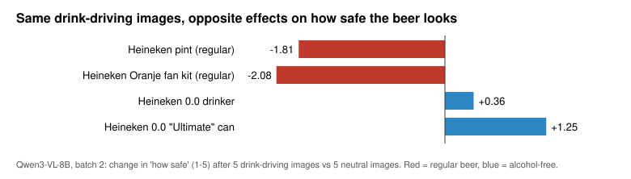
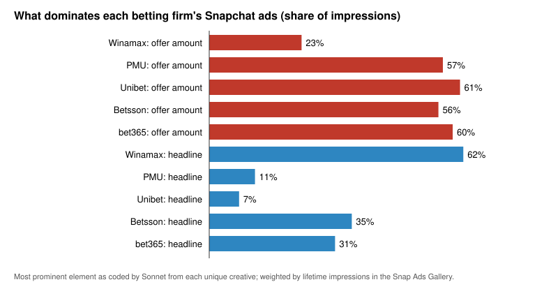

# Results

Generated by `python analysis/make_results.py` from the saved data in this repository. Do not edit by hand. Every table has a CSV twin in this folder.

Agent-feed ratings are the model's expected rating on a 1-5 scale (1 = low, 5 = high). Effects are the same ad after the named images minus the same ad after 5 neutral images, computed per ad and averaged over the ads in the category. `*` = 90% bootstrap interval over feeds within ad excludes zero (seeded; rough, because shared images across draws are ignored).

## Part 1. Agents reading ads in a feed (`agent-feeds/`)

### 1.1 Batch 1 measurement problem: the model ignored reversed scale labels

Means after recoding reversed answers; if the model read the labels, the two columns would match.

| question | normal scale | reversed scale (recoded) | feeds (normal / reversed) |
|---|---|---|---|
| better off | 1.76 | 4.03 | 292 / 276 |
| risk | 3.19 | 4.39 | 292 / 276 |
| pushiness | 2.94 | 3.34 | 292 / 276 |
| normal | 3.00 | 3.67 | 292 / 276 |
| appeal | 2.94 | 3.35 | 292 / 276 |

Behaviour questions in batch 1 were dead: P(spend 10 euros) exceeded 0.1 in 6.5% of 568 feeds, P(show the ad) in 0.5%.

### 1.2 Batch 1, clean (normal scale, 568 feeds): effect of the images before the ad (k = 1, 3, 5 pooled)

| ad | images before | better off | risk | pushiness | normal | appeal |
|---|---|---|---|---|---|---|
| Beer | pubs, beer gardens | +0.45* | -0.29* | +0.06 | +0.54* | +0.10* |
| Beer | drink-driving, crashes | +0.49* | +0.39* | +1.45* | -0.76* | -0.04 |
| Beer | amber look-alikes | +0.41* | +0.22* | +0.01 | +0.16* | +0.03 |
| Betting | winning | +0.05* | -0.04* | +0.14* | -0.38* | +0.10* |
| Betting | losing, distress | +0.13* | +0.02* | +0.32* | +0.06 | +0.22* |
| Betting | green/yellow look-alikes | +0.06* | -0.03* | +0.07* | +0.08* | -0.06* |
| Fanta/Nike | winning | +0.13* | +0.00 | -0.01* | -0.17* | +0.10* |
| Fanta/Nike | losing, distress | +0.39* | -0.01 | +0.00 | -0.18* | +0.07 |
| Fanta/Nike | pubs, beer gardens | +0.15* | +0.03* | +0.02* | -0.35* | +0.06 |

Betting ads sit near the ceiling on risk: across 56 ad x prime set x position cells the mean risk rating has median 4.94 and range 4.41-4.99 on the 1-5 scale.

### 1.3 Batch 1, dose and position (beer ads, difference vs neutral feed)

| images | position | risk | pushiness | normal | appeal |
|---|---|---|---|---|---|
| drink-driving, crashes | before_k1 | -0.16 | +0.30 | -0.31 | +0.06 |
| drink-driving, crashes | before_k3 | +0.30 | +1.35 | -0.87 | +0.05 |
| drink-driving, crashes | before_k5 | +1.04 | +2.69 | -1.11 | -0.22 |
| drink-driving, crashes | ad_first | +0.66 | +2.70 | -1.21 | -0.82 |
| pubs, beer gardens | before_k1 | -0.14 | +0.05 | +0.30 | +0.03 |
| pubs, beer gardens | before_k3 | -0.28 | -0.02 | +0.57 | +0.11 |
| pubs, beer gardens | before_k5 | -0.45 | +0.14 | +0.75 | +0.17 |
| pubs, beer gardens | ad_first | +0.39 | +0.81 | +0.51 | -0.31 |

### 1.4 Batch 1, the ad alone vs the ad after 5 neutral images

| ad | appeal alone | appeal, neutral feed | pushiness alone | pushiness, neutral feed |
|---|---|---|---|---|
| beer_heineken00_drinker | 3.78 | 3.00 | 1.88 | 1.35 |
| beer_heineken_glass | 3.83 | 3.61 | 4.29 | 1.10 |
| bet_bet365_firstbet | 3.22 | 2.39 | 4.94 | 4.46 |
| bet_betsson_100refund | 3.82 | 2.69 | 4.59 | 3.06 |
| bet_pmu_100cash | 3.80 | 2.59 | 4.97 | 4.53 |
| bet_unibet_10free | 3.57 | 2.19 | 4.97 | 4.68 |
| ctl_fanta_glass | 4.02 | 3.27 | 1.40 | 1.04 |
| ctl_nike_track | 4.00 | 4.04 | 1.05 | 1.02 |

### 1.5 Batch 2 run integrity

888 unique design feeds (manifest: 888); 24 answer rows re-written around crashes, 24 of them bit-identical to the original; 1 of 7104 scored answers put < 80% probability on the valid options; `git_dirty` = false.

### 1.6 Batch 1 replicates in batch 2 (ad after 5 images; batch 1 -> batch 2)

| ad | images before | risk | pushiness | normal | appeal |
|---|---|---|---|---|---|
| Heineken pint (regular) | drink-driving, crashes | +2.52 -> +2.10 | +3.11 -> +2.45 | -2.52 -> -2.18 | -0.41 -> -0.27 |
| Heineken pint (regular) | pubs, beer gardens | -0.55 -> -0.74 | +0.16 -> +0.09 | +0.96 -> +1.00 | +0.19 -> +0.37 |
| Heineken 0.0 drinker | drink-driving, crashes | -0.44 -> -0.52 | +2.27 -> +3.25 | +0.30 -> -0.13 | -0.03 -> -0.10 |
| Heineken 0.0 drinker | pubs, beer gardens | -0.36 -> -0.40 | +0.11 -> +0.16 | +0.54 -> +0.70 | +0.15 -> +0.32 |
| PMU (betting) | winning | +0.00 -> +0.00 | +0.35 -> +0.28 | -0.71 -> -0.58 | -0.38 -> -0.35 |
| Unibet (betting) | losing, distress | -0.01 -> -0.02 | +0.19 -> +0.22 | -0.03 -> +0.11 | +0.46 -> +0.40 |

### 1.7 Batch 2: 5 drink-driving images, by beer ad

| ad | risk | safe | normal |
|---|---|---|---|
| Heineken pint (regular) | +2.10 | -1.81 | -2.18 |
| Heineken Oranje fan kit (regular) | +0.48 | -2.08 | -1.04 |
| Heineken 0.0 drinker | -0.52 | +0.36 | -0.13 |
| Heineken 0.0 "Ultimate" can | -0.19 | +1.25 | +0.77 |

### 1.8 Batch 2, pooled effects (ad last, 1 or 5 images)

| ad | images before | risk | safe | pushiness | free to decide | normal | appeal | try it |
|---|---|---|---|---|---|---|---|---|
| Beer | pubs, beer gardens | -0.23* | +0.65* | +0.05* | +0.10* | +0.52* | +0.23* | +0.15* |
| Beer | drink-driving, crashes | +0.27* | -0.46* | +1.17* | +0.04* | -0.48* | +0.01 | -0.02 |
| Beer | amber look-alikes | +0.08* | +0.57* | -0.02 | -0.03* | +0.17* | +0.08* | +0.06* |
| Betting | winning | -0.03* | +0.03 | +0.13* | -0.21* | -0.49* | -0.02 | +0.23* |
| Betting | losing, distress | +0.00 | +0.11* | +0.19* | -0.10* | +0.07 | +0.18* | +0.34* |
| Betting | green/yellow look-alikes | +0.00 | +0.04* | +0.14* | -0.09* | +0.11* | -0.05* | +0.12* |
| Fanta/Nike | winning | -0.02* | -0.06* | -0.02* | -0.18* | -0.07 | +0.06* | -0.01 |
| Fanta/Nike | losing, distress | -0.02 | -0.39* | +0.00 | +0.01 | -0.38* | -0.01 | +0.12* |
| Fanta/Nike | pubs, beer gardens | +0.02 | +0.01 | +0.02* | -0.10* | -0.40* | -0.05 | -0.16* |

### 1.9 Batch 2, position (beer ads, difference vs neutral feed)

| images | position | risk | safe | pushiness | normal | appeal | try it |
|---|---|---|---|---|---|---|---|
| drink-driving, crashes | before_k1 | +0.07 | -0.35 | +0.34 | -0.32 | +0.06 | +0.04 |
| drink-driving, crashes | before_k5 | +0.47 | -0.57 | +2.00 | -0.65 | -0.04 | -0.08 |
| drink-driving, crashes | ad_first | +0.34 | -1.63 | +2.63 | -0.99 | -0.46 | -0.41 |
| pubs, beer gardens | before_k1 | -0.11 | +0.47 | +0.02 | +0.33 | +0.07 | +0.14 |
| pubs, beer gardens | before_k5 | -0.34 | +0.83 | +0.08 | +0.71 | +0.38 | +0.15 |
| pubs, beer gardens | ad_first | -0.01 | -0.59 | +0.76 | +0.39 | -0.20 | -0.18 |

### 1.10 Batch 2, reverse-worded twins (correlation across feeds)

| feeds | n | risk vs safe | pushiness vs free to decide |
|---|---|---|---|
| all | 888 | -0.86 | -0.78 |
| beer | 444 | -0.64 | -0.14 |
| betting | 222 | -0.09 | -0.02 |
| control | 222 | -0.41 | -0.46 |

## Part 2. Five betting firms' ads on Snapchat (`ad-library/`)

### 2.1 The panel

| firm | ads | pagination | unique creatives (base run) | campaign starts |
|---|---|---|---|---|
| Winamax | 1,000 | capped at quota | 119 | 2024-06-06 - 2026-10-16 |
| PMU | 605 | exhausted | 143 | 2026-03-02 - 2026-09-07 |
| Unibet | 466 | exhausted | 129 | 2024-01-30 - 2026-03-19 |
| Betsson | 1,000 | capped at quota | 198 | 2024-10-16 - 2026-06-02 |
| bet365 | 170 | exhausted | 87 | 2026-05-25 - 2026-09-04 |
| Total | 3,241 |  | 676 |  |

Ad types: APP_INSTALL 1,772, STORY 1,325, REMOTE_WEBPAGE 73, DEEP_LINK 63, REMINDER 8.

Coded unique creatives: 951. Tied to an event cue: 676 (71%); to a sport cue: 492 (52%). Records whose media sat only inside Story snaps (missed by the first collector, recovered by the backfill): 1,155 (1,155 of them Story ads). The invalidated first run stopped after 163 records. Labelling took 954 calls (cost-equivalent reported by the CLI: $95.65); the discovery pass 100 calls ($7.20).

### 2.2 Firm profiles

Shares of ads are unweighted; shares of impressions are weighted by lifetime impressions. Brand prominence max = coded 3 on the 0-3 scale.

| measure | Winamax | PMU | Unibet | Betsson | bet365 |
|---|---|---|---|---|---|
| share of panel impressions | 57% | 13% | 25% | 1% | 4% |
| ads featuring football | 51% | 57% | 63% | 86% | 95% |
| ads using a match-card template | 30% | 17% | 28% | 53% | 14% |
| impressions where the offer amount dominates | 23% | 57% | 61% | 56% | 60% |
| impressions where the headline dominates | 62% | 11% | 7% | 35% | 31% |
| impressions with maximal brand prominence | 26.4% | 43.5% | 75.5% | 76.0% | 99.9% |
| impressions per creative (millions) | 8.61 | 4.96 | 9.32 | 0.30 | 2.40 |
| ads per creative | 2.74 | 4.14 | 3.19 | 5.05 | 1.91 |
| creatives first run before 2025 | 183 | 0 | 32 | 50 | 0 |
| ads targeting men only | 99% | 5% | 100% | 95% | 0% |
| ads with an upper age limit | 77% | 14% | 89% | 0% | 0% |
| last campaign start | 2026-10-16 | 2026-09-07 | 2026-03-19 | 2026-06-02 | 2026-09-04 |

### 2.3 How similar are the firms' ads? (cosine similarity of firm vectors)

| pair | ad-text stems (by ads) | coded cues (by ads) | coded cues (by impressions) |
|---|---|---|---|
| Winamax-PMU | 0.581 | 0.625 | 0.730 |
| Winamax-Unibet | 0.368 | 0.783 | 0.778 |
| Winamax-Betsson | 0.704 | 0.831 | 0.778 |
| Winamax-bet365 | 0.422 | 0.693 | 0.726 |
| PMU-Unibet | 0.448 | 0.635 | 0.645 |
| PMU-Betsson | 0.414 | 0.565 | 0.579 |
| PMU-bet365 | 0.369 | 0.565 | 0.545 |
| Unibet-Betsson | 0.414 | 0.882 | 0.786 |
| Unibet-bet365 | 0.411 | 0.849 | 0.752 |
| Betsson-bet365 | 0.365 | 0.902 | 0.926 |

Summary over the ten pairs (min / mean / max): ad-text stems 0.365 / 0.450 / 0.704; coded cues by ads 0.565 / 0.733 / 0.902; coded cues by impressions 0.545 / 0.725 / 0.926.

### 2.4 Similarity of ads launched in the same month (coded cues, 2026)

| launch month | firms launching | mean pairwise similarity | Winamax-bet365 |
|---|---|---|---|
| 2026-01 | Winamax Unibet Betsson | 0.407 |  |
| 2026-02 | Winamax Unibet | 0.594 |  |
| 2026-03 | Winamax PMU Unibet | 0.643 |  |
| 2026-04 | Winamax PMU | 0.556 |  |
| 2026-05 | Winamax PMU bet365 | 0.424 | 0.648 |
| 2026-06 | Winamax PMU Betsson bet365 | 0.765 | 0.726 |
| 2026-07 | Winamax PMU bet365 | 0.354 | 0.628 |
| 2026-08 | Winamax bet365 | 0.246 | 0.246 |
| 2026-09 | Winamax PMU bet365 | 0.518 | 0.47 |

### 2.5 Most representative features (firm share / rival share, impression-weighted)

| firm | rank | feature | ratio |
|---|---|---|---|
| Winamax | 1 | `lvl:poker_tournament` | 5.6x |
| Winamax | 2 | `of:prize_pool_or_jackpot` | 5.4x |
| Winamax | 3 | `bm:humour_wordplay` | 4.0x |
| PMU | 1 | `lvl:racing_event` | 18.7x |
| PMU | 2 | `sp:horse_racing` | 11.8x |
| PMU | 3 | `of:cash_bonus` | 7.0x |
| Unibet | 1 | `of:no_deposit_bonus` | 46.4x |
| Unibet | 2 | `sp:combat_sports` | 10.1x |
| Unibet | 3 | `fr:not_shown` | 3.4x |
| Betsson | 1 | `lvl:other_single_fixture` | 3.6x |
| Betsson | 2 | `of:first_bet_refund_or_guarantee` | 2.6x |
| Betsson | 3 | `fr:product_or_service_utility` | 2.1x |
| bet365 | 1 | `lvl:national_team_or_major_tournament` | 5.1x |
| bet365 | 2 | `bm:national_pride` | 3.8x |
| bet365 | 3 | `of:boosted_odds` | 3.0x |

### 2.6 The earlier 1,000-ad Snapchat corpus (betting, alcohol, controls)

| measure | value |
|---|---|
| ads | 1000 |
| category: alcohol | 250 |
| category: betting | 250 |
| category: control | 500 |
| country: de | 200 |
| country: fr | 600 |
| country: nl | 200 |
| records with media (collector) | 709 |
| unique media files (collector) | 494 |
| media requests answered HTTP 403 | 23 |
| records with media after Story backfill | 896 |

## Part 3. Celebrity-brand associations (`brand-associations/`)

### 3.1 Directed association: does the celebrity retrieve the brand more than the reverse?

Asymmetry = log P(brand | celebrity) - log P(celebrity | brand) for the 23 pilot ambassador pairs; slope = regression of asymmetry on log(brand pageviews / celebrity pageviews) over all celebrity x brand cells (HC1 standard errors).

| measure | pairs | share celebrity -> brand stronger | median asymmetry | slope on size ratio (se) | cells |
|---|---|---|---|---|---|
| embed_st-baai-bge-base-en-v1-5 | 23 | 35% | -0.14 | +0.16 (0.02) | 660 |
| embed_st-suproteem-representlm-v2 | 23 | 48% | -0.22 | +0.23 (0.04) | 660 |
| llm_qwen3-8b-4bit | 23 | 57% | +1.11 | +2.08 (0.11) | 660 |

### 3.2 Multi-source association profiles (110-entity frame, 73 ambassador pairs)

Of 73 ambassador pairs, 40 run forward (the brand is a bigger part of the celebrity than the reverse), 12 backward and 21 flat. Correlation between direction and log10(celebrity pageviews / brand pageviews): -0.55 (n = 53 pairs with a link in at least one source). Sydney Sweeney x Novig is backward by a factor of 14.6. LeBron James names Nike in 57% of the language model's free-association lists; in news, Nike appears in 17.7% of LeBron's articles and LeBron in 9.7% of Nike's; across the five sources the pair is forward in 2 and backward in 2.

### 3.3 Study C: items in the same celebrity outfit compete for search attention

73 brand mentions in 20 Taylor Swift game-day looks; 61 with measurable Google Trends search. Lift = days 0-3 vs same-weekday baseline.

| brands identified in the look | items | mean log lift | lift |
|---|---|---|---|
| 1 | 4 | +3.34 | x28.1 |
| 2-3 | 18 | +1.19 | x3.3 |
| 4-6 | 20 | +0.42 | x1.5 |
| 7-9 | 19 | +0.10 | x1.1 |

Slope of log lift on log(number of brands), tier controls: -0.798 (t -2.23). Within-look (look fixed effects), first-named item: +0.955 log points (t +2.71); relative to the look mean, first-named +0.72, others -0.26.

### 3.4 Demo spillover: search z-scores, days 0-3 (read from the pipeline's saved table)

| case | source | term | role | z |
|---|---|---|---|---|
| taylor_nb550 | google_trends | Taylor Swift New Balance | focal_link | 11.56 |
| taylor_nb550 | google_trends | Taylor Swift Nike | competitor_link | 2.69 |
| taylor_nb550 | google_trends | New Balance 550 | focal | 1.1 |
| kanye_energy_boost | google_trends | Energy Boost | focal | 2.62 |
| kanye_energy_boost | google_trends | Ultra Boost | sibling | 0.58 |
| bieber_crocs | google_trends | Justin Bieber Crocs | focal_link | 11.2 |
| bieber_crocs | google_trends | Crocs | focal | 0.07 |
| bieber_crocs | wikipedia_pageviews | Crocs | focal | 1.98 |
